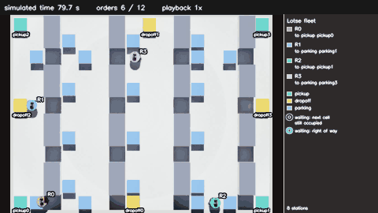
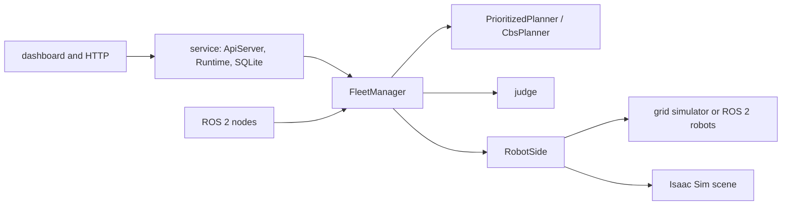

# Lotse



Lotse is a multi-robot fleet manager for a warehouse, written in C++20. It takes
transport orders ("bring a box from shelf 12 to packing station 3"), assigns each
order to a robot, plans collision-free routes for the whole fleet, and keeps the
fleet safe when robots run late. The core is a plain C++ library with no ROS
dependency; a grid simulator, a ROS 2 stand-in simulator and NVIDIA Isaac Sim
all drive the same code, and an independent judge checks for contacts.

## Headline results

| result | number |
|---|---|
| [Safety under injected delays](docs/results.md#1-safety-under-injected-delays) | 0 of 1,000 runs with a collision or swap (200 of them have no delay), against 547 of the 800 delayed runs (68.4%) with the rule off |
| [Real-time planning modes](docs/results.md#2-real-time-planning-modes) | 1,080 of 1,080 runs finish with 0 slow and 0 frozen, against 266–276 slow and 201–210 frozen over three complete runs of the old background mode |
| [Planner comparison](docs/results.md#3-planner-comparison) | prioritized planning solves 40 of 40 scenarios at 25 robots (0.168 s mean); CBS solves 14 of 40 |
| [Throughput](docs/results.md#4-throughput) | 186.7 orders per 1,000 steps at 20 robots without delays, the mean over the five maps (672.0 per hour, with one step counted as one second) |
| [ROS 2 integration set](docs/results.md#5-ros-2-integration-set) | 21 runs, 432 orders, 0 contacts, 0 deadlocks |
| [Isaac Sim runs](docs/results.md#6-isaac-sim-runs) | 4 runs of 12 orders, 12 of 12 orders each, 0 judge and 0 simulator contacts |

Every number is in `results/` and comes from a script in `scripts/`.

## Quick start

Requirements: Linux with Docker and Docker Compose. The Isaac Sim demo also
needs an NVIDIA GPU with its driver, the NVIDIA container toolkit and the
`nvcr.io/nvidia/isaac-sim:5.1.0` image. Nothing is installed on the host.

### The service with the dashboard

```bash
./scripts/run_service.sh
```

Then open `http://127.0.0.1:8080/` for the live dashboard. Submit an order:

```bash
curl -X POST http://127.0.0.1:8080/orders \
  -H 'Content-Type: application/json' \
  -d '{"pickup":"pickup0","dropoff":"dropoff0"}'
```

Read the counters, including the number of completed orders:

```bash
curl -s http://127.0.0.1:8080/throughput
```

Stop the service:

```bash
./scripts/stop_service.sh
```

### The quality gate

```bash
./scripts/check.sh
```

This builds the development image and runs clang-format, the C++ build with
warnings as errors, the unit tests, the address/undefined and thread sanitizers,
clang-tidy and the colcon build of the ROS 2 packages.

### The benchmarks

```bash
./scripts/run_safety_benchmark.sh
./scripts/run_continuous_safety_benchmark.sh
./scripts/run_throughput_benchmark.sh
./scripts/run_planner_comparison.sh
./scripts/run_liveness_benchmark.sh
./scripts/clock_test.sh
```

Each writes its result files into `results/`. The charts in `docs/images/` are
drawn from those files by:

```bash
docker run --rm -v "$PWD:/workspace" -w /workspace lotse-dev:jazzy \
  python3 scripts/make_charts.py
```

### The ROS 2 run on the stand-in simulator

```bash
./scripts/run_ros2.sh
```

Extra arguments are passed to the launch file, for example
`./scripts/run_ros2.sh fleet_size:=10 map_path:=maps/warehouse_large.map`.

### The Isaac Sim demo

```bash
./scripts/run_isaac_video.sh   # one recorded run with the labelled video, clip, GIF and stills
./scripts/run_isaac_runs.sh    # the four result runs, no recording
```

## Architecture



The full picture, including how an order flows and which threads run, is in
[docs/architecture.md](docs/architecture.md).

## Design decisions

**The pass-order rule.** A plan fixes, for every cell, the order in which robots
pass through it, and a robot may enter a cell only after the robot scheduled
before it there has left. The rule is per cell and uses each robot's position
along its own route, so uneven speeds and late robots do not break it. With the
rule on, 0 of 1,000 runs end with a collision or a swap (200 of the 1,000 have
no delay); with it off, 547 of the 800 delayed runs (68.4%) do
(`results/safety_summary.txt`, `results/safety_control_runs.csv`).

**Planning from the current positions replaced background planning.** A
background plan was computed from a snapshot of the robot positions. By the time
the worker returned, the robots had moved, and re-anchoring each robot
independently shifted its timeline, which could invert the per-cell order and
freeze the fleet. Planning inside the tick, from the state the tick just read,
removes the shift. Three complete runs of the old mode gave 266–276 slow and
201–210 frozen runs out of 1,080; it is not reproducible, because its plan
worker runs under a wall-clock limit. Planning from the current positions
without the stable order is 5 slow and 0 frozen
(`results/liveness_stale_plans_summary.txt`,
`results/liveness_current_positions_pre_stable_runs.csv`).

**The stable planning order.** The remaining slow runs came from the
farthest-first planning order: two robots moving toward each other traded right
of way at every replan as their remaining distances crossed. The planner now
keeps a robot's place in the order while its goal is unchanged, and only falls
back to the other orders when the stable order fails to route. This takes the
1,080-run set from 5 slow and 0 frozen to 0 slow and 0 frozen
(`results/liveness_current_plans_summary.txt`).

**Progress detection.** The manager reports a no-progress alarm when, for 120
simulated seconds, no order has completed and the fleet's total remaining
distance has not reached a new lowest value. It reports the alarm on the health
and throughput endpoints and in the result files; it does not replan or park by
itself.

**Two planners.** `PrioritizedPlanner` plans robots one at a time and reserves
each route before the next, which is fast and good enough for real time.
`CbsPlanner` is conflict-based search, which returns the shortest total route set
within its horizon but does not scale past about 15 to 20 robots. The real-time
paths use prioritized planning; CBS exists to check its solution quality and to
show the trade-off.

## Limitations

- The robot position comes straight from the simulator. There is no
  localization; a real deployment would need one.
- The forward range sensor in Isaac Sim is 20 physics ray casts published as a
  laser scan, not a LiDAR model.
- The Isaac Sim demo runs 4 robots. The grid benchmarks go to 20.
- Each station serves one robot at a time, so stations become the throughput
  limit as the fleet grows.
- CBS times out on dense maps beyond about 15 to 20 robots.
- Progress detection reports the alarm; it does not act on it.
- The clock test compares the finish-time difference against the spread it
  measures, because the robot's cell report and the physics run on different
  timers.
- The service has no login and listens on the local machine only
  (`127.0.0.1:8080`).

## Repository layout

| Path | Contents |
|---|---|
| `core/` | The plain C++20 library with no ROS dependency. All fleet logic lives here. |
| `tests/` | GoogleTest unit tests for the core and service. |
| `apps/` | Benchmark and demo executables. |
| `service/` | The HTTP/WebSocket server, SQLite order store and dashboard. |
| `ros2/` | ROS 2 Jazzy packages (`ament_cmake`). Thin wrappers around `core/`. |
| `sim/isaac/` | The Isaac Sim scene script (the only Python in the project). |
| `scripts/` | The quality gate, the benchmarks, the demo scripts, the video encoder and the chart script. |
| `results/` | Result files written by the benchmarks. |
| `docs/` | The architecture page, the results page and the chart images. |
| `media/` | The demo clip, GIF and still for this README. |
| `maps/`, `config/`, `docker/`, `docker-compose.yml` | Warehouse maps, service configuration, images and Compose. |
| `.github/workflows/` | CI that runs the same checks as `scripts/check.sh`. |
