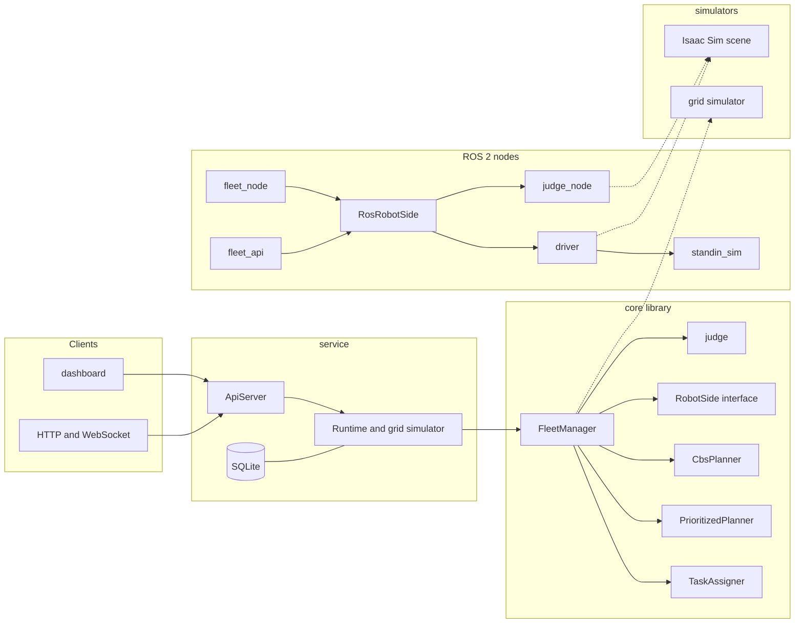

# Architecture

Lotse has one fleet-management core and several ways to drive and observe it.
The core is a plain C++20 library with no ROS dependency. The grid simulator,
the ROS 2 stand-in simulator and Isaac Sim all reach it through the same small
interface, and the same planners, order stream and safety judge are used in
every mode.

## Components

**Core library (`core/`).** The warehouse map and grid (`Map`, `GridCell`),
single-robot space-time search (`searchRoute`), the planner interface
(`Planner`), the two planners, the task assigner, the real-time fleet manager
(`FleetManager`), the order stream and ageing, the independent judge
(`judge::analyse`) and the clock interface (`Clock`).

**Planners.** `PrioritizedPlanner` plans robots one at a time and reserves each
route before planning the next; it is fast and not optimal. `CbsPlanner` is
conflict-based search: its low level reuses the same `searchRoute`, its high
level branches on conflicts until none remain, so within its horizon it returns
the shortest total route set. Both sit behind `Planner`, so the manager does not
know which one it holds.

**Pass-order rule.** A plan is a route per robot plus, for every cell, the order
in which robots pass it. A robot may enter a cell only when the robot scheduled
before it there has left. The rule is per cell and uses each robot's position
along its own route, so uneven speeds and late robots do not break it. The
manager also keeps a physical occupancy gate as a safety net: a robot never
enters a cell another robot's body occupies.

**Fleet manager (`FleetManager`).** A long-running object that ticks in
simulated time. Each tick it releases due orders, assigns them, plans from the
robots' current positions (inside the tick, by default), publishes the cells
each robot may enter under the pass-order rule, reads back true positions and
advances the robot side. It replans on a window, detects no progress, and
reports counters and a safety verdict.

**Robot side (`RobotSide`).** The one boundary between the manager and whatever
drives the robots: send the cells a robot may enter, read back its status. The
grid simulator, the ROS 2 stand-in and the real ROS 2 robots implement it.

**Service (`service/`).** `Runtime` runs the core manager against the grid
simulator and implements `FleetApiSource`. `ApiServer` serves the shared HTTP
and JSON routes and the WebSocket feed; `fleet_json` builds the documents from
the core types. `SqliteOrderStore` persists orders and their events. The
dashboard in `service/dashboard/` is a small web page served by the same server.

**ROS 2 nodes (`ros2/lotse_ros`).** `RosRobotSide` implements `RobotSide` over
`nav_msgs` topics. `driver` is the per-robot node that turns allowed waypoints
into `cmd_vel`, reads odometry and a forward scan, and stops if something is
close. `standin_sim` is a time-scaled differential-drive simulator for tests.
`judge_node` is the independent contact judge. `fleet_node` runs the manager
against the stand-in simulator; `fleet_api` runs it against Isaac Sim and serves
the dashboard. `RosClock` drives every node from the simulator `/clock`.

**Isaac Sim scene (`sim/isaac/`).** A Python script builds the warehouse from the
same map file, places one Carter per parking cell, wires `cmd_vel` to the
wheels, publishes `/clock`, true poses, a forward raycast scan and contact
reports, and records an overhead video.

## How an order flows

1. An order arrives from the HTTP API, the dashboard or the generated stream,
   and is validated against the map's pickup and drop-off stations.
2. The manager stores it as pending and the task assigner picks a free robot.
3. A plan is computed for the whole fleet. The manager adopts it only when
   every robot can be anchored at the plan's start, builds the per-cell order
   from the plan, and publishes the next allowed cell to each robot.
4. The robot side drives the robot. Under delays, the pass-order gate holds a
   robot at its cell until the robot ahead has left; the manager replans when a
   robot is far behind and reports a no-progress alarm if the fleet stops making
   progress.
5. When a robot reaches the pickup its order becomes in progress; at the
   drop-off the order completes and a SQLite event and a dashboard update are
   written. The robot returns to parking and becomes free.

## Threads

- **Service.** A ticker thread runs the manager at `tick_hz`. The HTTP server
  runs on its own thread and reads the manager through a mutex. SQLite is
  written from the ticker thread. A background planning worker exists but is off
  in every real-time path, so planning happens on the tick thread.
- **ROS 2 fleet nodes.** One executor spins the manager timer, the robot-side
  subscriptions and the driver status callbacks. The driver, stand-in simulator
  and judge each run in their own process with their own timer.
- **Isaac Sim.** The scene runs a render/physics loop and a small `rclpy` node
  for the true poses and the raycast scan. The operator nodes follow `/clock`.
- **Judge.** A separate node with its own timer, sharing no code with the
  manager or the driver.

## Diagram

Solid arrows are calls inside one process; dashed arrows are the simulator
behind an interface or a ROS topic boundary. In the service the robot side is
the grid simulator; in `fleet_node` it is the stand-in simulator; in `fleet_api`
it is Isaac Sim over ROS 2.
