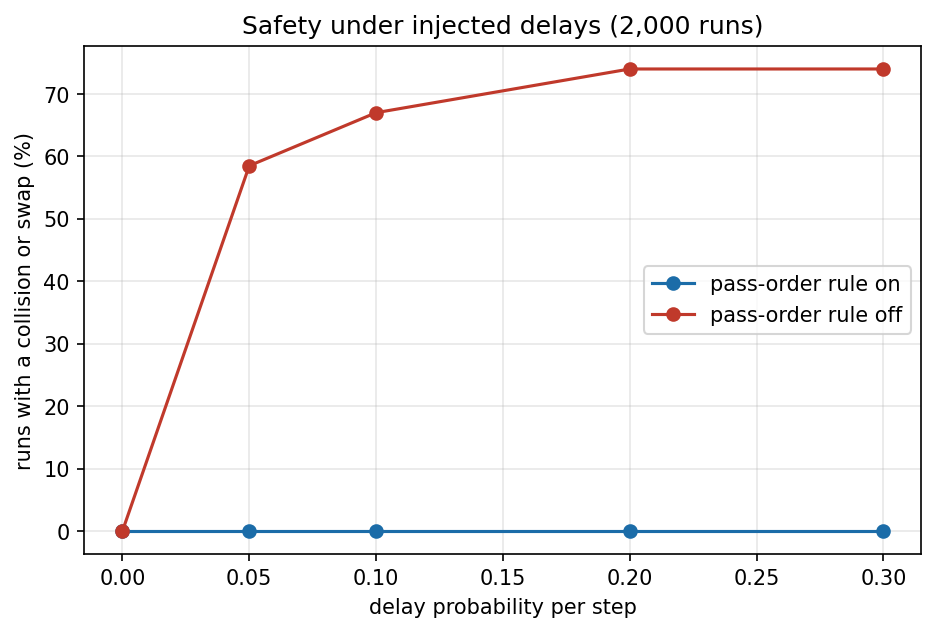
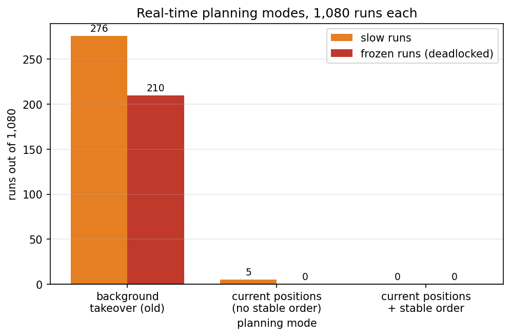
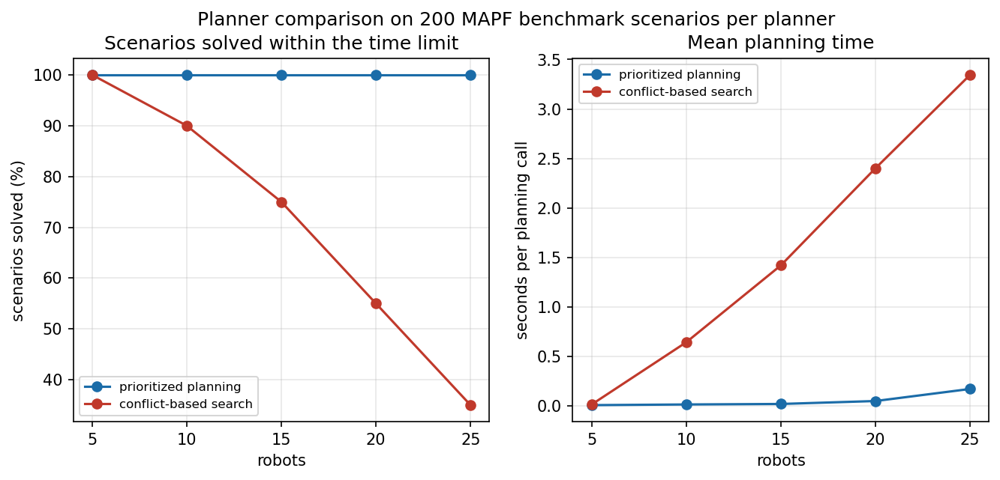
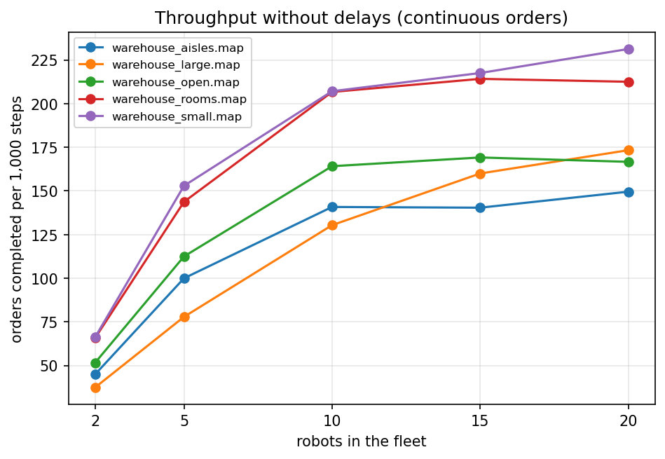

# Results

Every number on this page comes from a result file in `results/` that a script
in `scripts/` wrote. All commands are run from the repository root. The charts
are drawn from the same result files by `scripts/make_charts.py`.

Where a result is not exactly reproducible (wall-clock planning times, the
non-deterministic ROS 2 runs, the old background planning mode), the spread is
stated with the number.

## 1. Safety under injected delays

**What is measured.** Injected delays create the late-running robots the project
is about. Two modes are compared: the pass-order rule on, and the same runs with
the rule off. A run is bad when the independent judge sees at least one
collision or swap. The continuous variant adds orders that arrive as a stream.

**Command.** `./scripts/run_safety_benchmark.sh` and
`./scripts/run_continuous_safety_benchmark.sh`

**Result files.** `safety_runs.csv`, `safety_summary.txt`,
`safety_control_runs.csv`, `continuous_safety_runs.csv`,
`continuous_safety_summary.txt`.

| delay | pass-order: bad runs | control: bad runs | control: collisions | control: swaps |
|---|---|---|---|---|
| 0.000 | 0 / 200 (0.0 %) | 0 / 200 (0.0 %) | 0 | 0 |
| 0.050 | 0 / 200 (0.0 %) | 117 / 200 (58.5 %) | 805 | 20 |
| 0.100 | 0 / 200 (0.0 %) | 134 / 200 (67.0 %) | 1017 | 40 |
| 0.200 | 0 / 200 (0.0 %) | 148 / 200 (74.0 %) | 1402 | 71 |
| 0.300 | 0 / 200 (0.0 %) | 148 / 200 (74.0 %) | 1622 | 67 |
| **all** | **0 / 1000 (0.00 %)** | **547 / 800 delayed (68.4 %)** | 4846 | 198 |

The 1,000 runs are 200 scenarios at five delay levels, and the 0.000 level has
no delay, so 200 of the 1,000 runs are undelayed. All 547 bad control runs are
in the 800 delayed runs.

The continuous stream gives the same picture: with the rule on 0 of 300 runs
are bad, with the rule off 185 of the 200 delayed runs (92.5 %) are bad (the
third of the 300 runs is undelayed), with 5002 collisions and 172 swaps.

The pass-order rule is what keeps two robots out of one cell when a robot is
late. With the rule off, more than half of the runs at any non-zero delay end
with a collision or a swap.

## 2. Real-time planning modes

**What is measured.** 1,080 seeded current-positions runs on four maps, fleets
of 4, 10 and 20 robots, three cell-crossing times and 30 seeds each. The
liveness benchmark calls a run **slow** when it does not finish within three
times the same order list's discrete baseline, and **frozen** when the manager's
deadlock flag fires. Three planning modes are compared: the old background
takeover, planning from the current positions without the stable order, and the
final mode with the stable planning order.

**Command.** `./scripts/run_liveness_benchmark.sh`

**Result files.** `liveness_stale_plans_runs.csv`,
`liveness_current_positions_pre_stable_runs.csv`,
`liveness_current_plans_runs.csv` and their `_summary.txt` files.

| mode | completed | slow | frozen | ratio median / p95 / largest |
|---|---|---|---|---|
| background takeover (old, not reproducible) | 824 / 1080 in the committed run | 266–276 | 201–210 | 1.40433 / 3.42453 / 8.99281 |
| current positions (no stable order) | 1075 / 1080 | 5 | 0 | 1.09160 / 1.35472 / 3.07377 |
| current positions + stable order | **1080 / 1080** | **0** | **0** | 1.08392 / 1.33472 / 1.68889 |

Planning from the current positions inside the tick removed the stalls caused
by a stale background plan. The stable planning order then removed the five
remaining slow runs on `warehouse_large`.

**Spread.** The old background mode is not reproducible because its worker
thread runs under a wall-clock limit. Three complete runs gave 266, 276 and 268
slow and 204, 210 and 201 frozen runs out of 1,080; the committed file holds the
third run (276 slow, 210 frozen). The committed run also reports 256 runs that
**did not finish** (`stalled`), which is a different quantity from frozen; that
is where the number 256 in an earlier draft came from. The other two modes are
deterministic in their outcome columns.

## 3. Planner comparison

**What is measured.** Prioritized planning and conflict-based search on four
public MAPF benchmark maps (empty, maze, random, room; 32x32) at 5 to 25 robots,
10 scenarios each, with a 5-second limit per planning call. Reported are the
share of scenarios solved and the mean planning time.

**Command.** `./scripts/run_planner_comparison.sh`

**Result files.** `planner_comparison_runs.csv`,
`planner_comparison_summary.txt`, `planner_comparison_lotse_hard.txt`.

| robots | prioritized: solved | prioritized: mean s | CBS: solved | CBS: mean s |
|---|---|---|---|---|
| 5 | 40 / 40 (100 %) | 0.0046 | 40 / 40 (100 %) | 0.0113 |
| 10 | 40 / 40 (100 %) | 0.0115 | 36 / 40 (90 %) | 0.6406 |
| 15 | 40 / 40 (100 %) | 0.0166 | 30 / 40 (75 %) | 1.4182 |
| 20 | 40 / 40 (100 %) | 0.0463 | 22 / 40 (55 %) | 2.4002 |
| 25 | 40 / 40 (100 %) | 0.1683 | 14 / 40 (35 %) | 3.3444 |

CBS finds shorter routes (its mean cost is lower on every map in
`planner_comparison_summary.txt`) but it does not scale: beyond about 15 to 20
robots it runs out of time, while prioritized planning solves every scenario and
its planning time stays below 0.2 s. On the dense `warehouse_aisles` map with 20
robots, prioritized planning solves the scenario in 0.343 s and CBS times out
after 62.098 s (`planner_comparison_lotse_hard.txt`).

**Spread.** CBS planning times are wall-clock and move run to run; the mean is
reported rather than a single value.

## 4. Throughput

**What is measured.** Continuous orders, one grid step is one second. Orders
completed per 1,000 steps and per hour as the fleet grows, with and without
injected delays.

**Command.** `./scripts/run_throughput_benchmark.sh`

**Result files.** `throughput_runs.csv`, `throughput_summary.txt`,
`throughput_prioritized_runs.csv`, `throughput_cbs_runs.csv`,
`throughput_planner_comparison.txt`, `throughput_below_runs.csv`,
`throughput_below_summary.txt`.

| robots | no delay: per 1,000 steps | no delay: per hour | delayed: per 1,000 steps | delayed: per hour |
|---|---|---|---|---|
| 2 | 53.2 | 191.7 | 47.8 | 171.9 |
| 5 | 117.4 | 422.7 | 101.2 | 364.2 |
| 10 | 169.8 | 611.4 | 150.2 | 540.9 |
| 15 | 180.2 | 648.9 | 159.8 | 575.4 |
| 20 | 186.7 | 672.0 | 161.9 | 582.9 |

The per-fleet table is the mean over the five maps (`warehouse_aisles`,
`warehouse_large`, `warehouse_open`, `warehouse_rooms`, `warehouse_small`) with
four seeds each; `throughput_summary.txt` also lists the per-map numbers. The
"per hour" column uses one simulation step = one second.

Throughput rises steeply to about 10 robots and then flattens: the stations,
not the fleet, become the limit. Injected delays cost 10 to 13 percent of
throughput. The `throughput_below_*` files hold a deliberately pessimistic
variant where every step is slower; the number of robots still barely changes
the result there.

## 5. ROS 2 integration set

**What is measured.** The real ROS 2 nodes (driver, stand-in simulator, judge,
fleet manager) run the same scenarios through the ROS 2 transport with the
simulator clock. Safety is the judge's contact count from true positions; the
manager's own grid counter is reported separately.

**Command.** `./scripts/run_ros2_integration.sh`

**Result file.** `ros2_integration.txt`, `ros2_integration_runs.csv`.

| setup | runs | orders | ok | contacts | deadlocks | closest m | grid | rejections |
|---|---|---|---|---|---|---|---|---|
| small-4 | 10 | 120 / 120 | 10 | 0 | 0 | 0.824 | 0 | 0 |
| large-10 | 10 | 300 / 300 | 10 | 0 | 0 | 0.738 | 0 | 0 |
| obstacle | 1 | 12 / 12 | 1 | 0 | 0 | 0.851 | 0 | 0 |

Planning cost (tick period 50 ms): large-10 1,742 calls, worst per-run p95
3.67 ms, worst per-run max 6.59 ms; small-4 627 calls, worst p95 0.42 ms, worst
max 0.98 ms; obstacle 80 calls, worst p95 0.99 ms, worst max 2.52 ms.

The 10-robot set that used to stall now completes every order with zero
contacts. Every run has zero plan rejections, which is the signature of the
inline current-position planning mode.

**Spread.** The ROS 2 runs are not deterministic (`min_distance`, `robots_used`
and the planning cost differ run to run). The outcome columns above are
identical across the set.

## 6. Isaac Sim runs

**What is measured.** Four Carter robots in NVIDIA Isaac Sim on
`warehouse_small`, a fixed list of 12 orders, seeds 1 to 3 plus one run with a
dynamic obstacle. Contacts are the independent judge on the simulator's true
poses and the simulator's own contact reports.

**Command.** `./scripts/run_isaac_runs.sh` (four runs, no recording) and
`./scripts/run_isaac_video.sh` (one recorded run with the labelled video).

**Result files.** `isaac_runs.csv`, `isaac_summary.txt`.

| run | orders | judge | sim | deadlock | grid | closest m | calls | longest call ms | rejections | sim s | real s |
|---|---|---|---|---|---|---|---|---|---|---|---|
| seed1 | 12 / 12 | 0 | 0 | false | 0 | 0.953 | 61 | 0.149 | 0 | 235.6 | 215.2 |
| seed2 | 12 / 12 | 0 | 0 | false | 0 | 0.978 | 64 | 0.186 | 0 | 241.9 | 223.3 |
| seed3 | 12 / 12 | 0 | 0 | false | 0 | 0.912 | 69 | 0.139 | 0 | 279.1 | 251.1 |
| obstacle | 12 / 12 | 0 | 0 | false | 0 | 0.970 | 58 | 0.209 | 0 | 247.2 | 230.5 |

The recorded seed-1 run also completes 12 of 12 orders with 0 judge and 0
simulator contacts, no deadlock, 0 manager collisions and no progress alarm.

The obstacle run places a box 12 simulated seconds in front of moving robot 0
and removes it 12 seconds later. The driver stops for 170 manager frames while
the box is there; the fleet routes around it and completes every order.

**Spread.** The real duration moves with the host GPU load; the simulated
duration and the outcome columns are stable. The recorded run is one seed only.

## 7. Clock test

**What is measured.** The same seeded scenario run at `time_scale` 1.0 and 4.0.
The check requires the same orders completed, zero contacts, zero deadlocks,
zero manager grid collisions, and a median finish-time difference no larger
than the larger within-scale spread.

**Command.** `./scripts/clock_test.sh`

**Result file.** `clock_test.txt`.

| time scale | completed | contacts | deadlocks | grid | simulated finish s |
|---|---|---|---|---|---|
| 1.0 (3 repeats) | 12 / 12 | 0 | false | 0 | 230.0, 230.1, 242.5 |
| 4.0 (3 repeats) | 12 / 12 | 0 | false | 0 | 237.0, 238.86, 230.1 |

Medians 230.1 s against 237.0 s; difference 6.9 s; within-scale spread 12.5 s
(1.0x) and 8.76 s (4.0x); tolerance 12.5 s. **PASS.**

The test compares the difference against the spread it measures, because the
robot's cell report and the physics run on different timers, so a cell-boundary
crossing can fall just before or just after a manager tick. That is why the
tolerance is the measured spread and not a fixed number.
